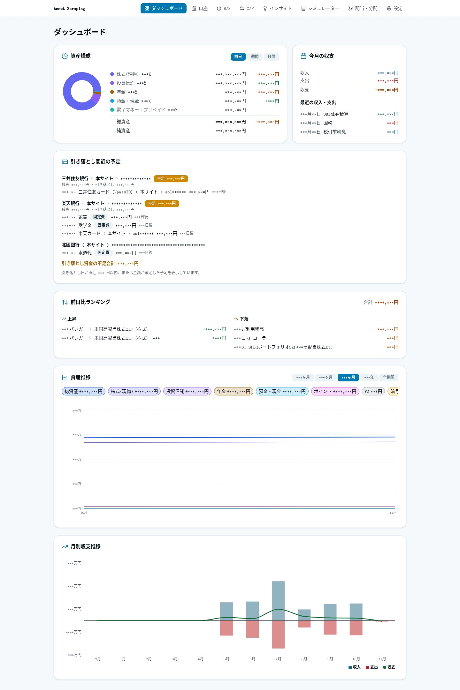
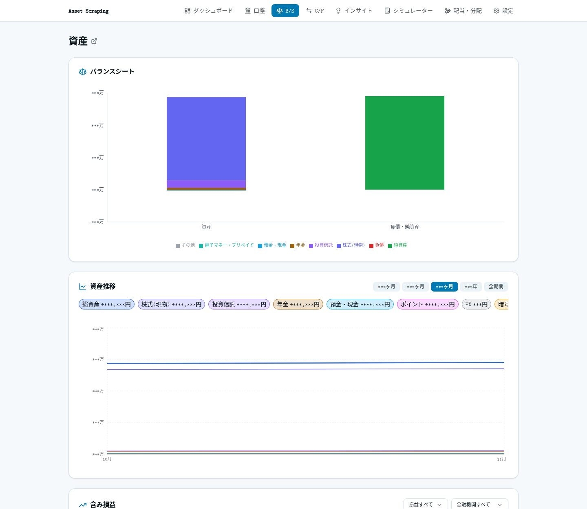
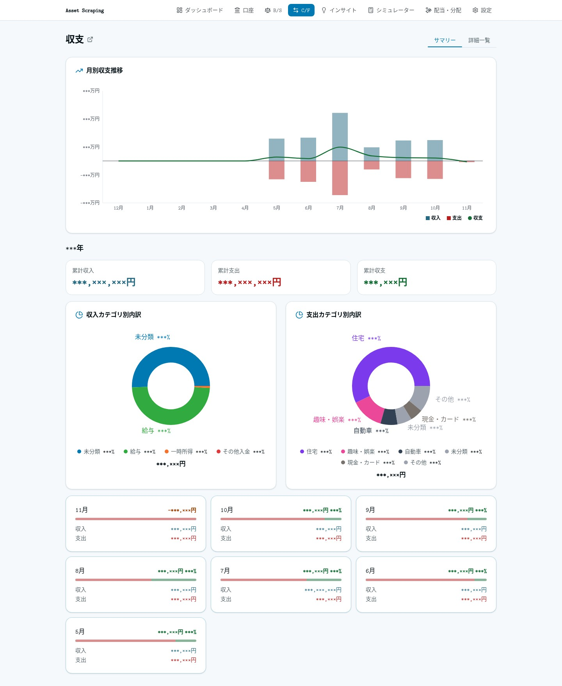
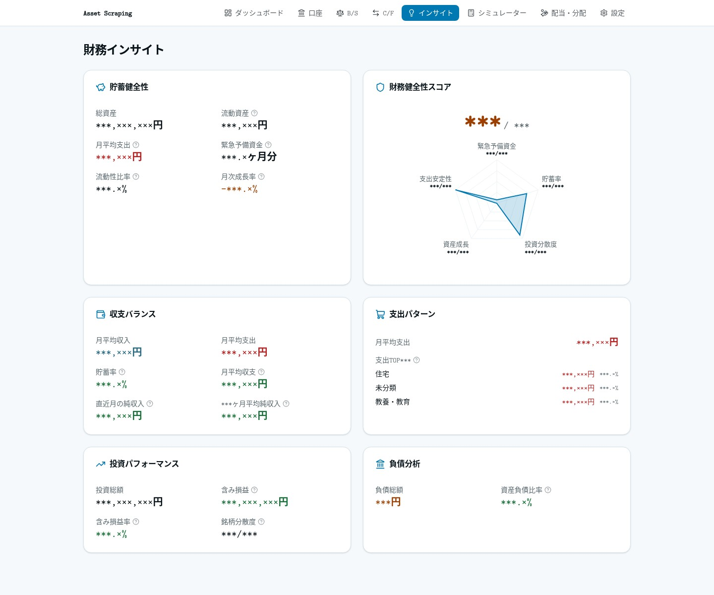
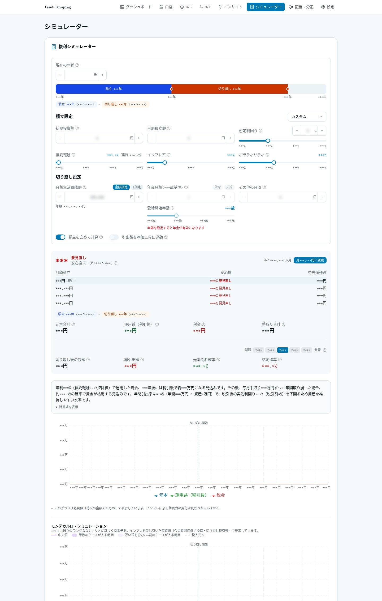
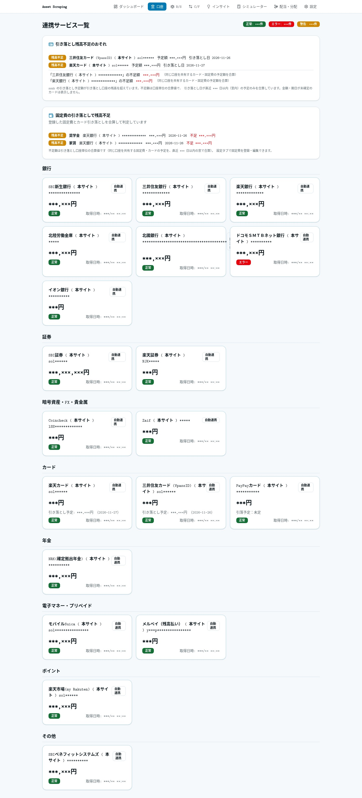
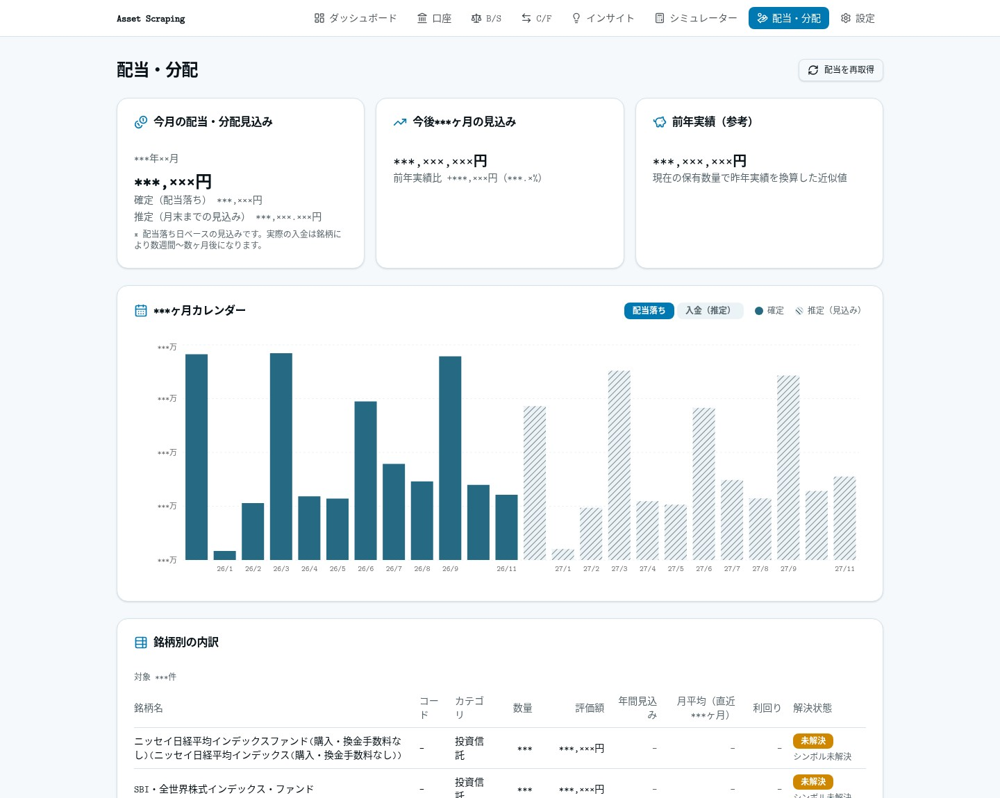
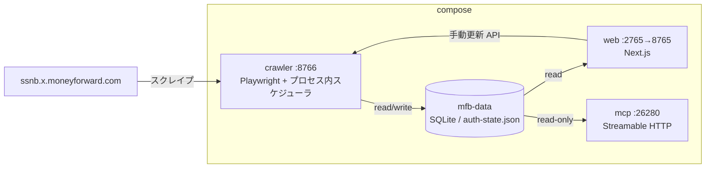

<p align="center">
  
</p>

<h1 align="center">Asset Scraping</h1>

<p align="center">
  <a href="https://github.com/solidlime/AssetScraping/actions/workflows/docker.yml"></a>
</p>

Money Forward SSNB（ssnb.x.moneyforward.com）の画面を Playwright で取り込み、資産と収支を 1 枚のダッシュボードにまとめる自宅運用向けのツール。取得したデータは SQLite に貯まり、同じ DB を 8 つの MCP ツールとして AI エージェントからも読める。



**Contents**

- [セットアップ](#セットアップ)
- [機能](#機能)
- [画面](#画面)
- [設定](#設定)
- [MCP サーバー](#mcp-サーバー)
- [アーキテクチャ](#アーキテクチャ)
- [イメージの配布](#イメージの配布)
- [制限](#制限)
- [ライセンス](#ライセンス)

## セットアップ

必要なもの: Docker（amd64）と ssnb のアカウント。手元で直接動かす場合だけ Node 24 と pnpm 12.5.1 も要る。

```sh
git clone https://github.com/solidlime/AssetScraping.git
cd AssetScraping
printf 'SSNB_LOGIN_ID=your-id\nSSNB_PASSWORD=your-password\n' > .env
docker compose up -d crawler web mcp
```

初回だけ、コンテナの中で ssnb にログインして storageState を保存する。二段階認証のコードを聞かれたらそのまま入力する。

```sh
docker compose run --rm crawler sh -c 'cd apps/crawler && node_modules/.bin/tsx src/login.ts'
```

ブラウザからログインしたい場合は noVNC の画面を使う。`http://localhost:8767/vnc.html` を開き、映った Chromium で ssnb にログインすると `/data/auth-state.json` が更新される。

```sh
docker compose up login-web
```

初回はデータが空なので、右上の「今すぐ更新」を押すか、設定した定期更新時刻を待つ。

認証情報と DB は名前付き volume `mfb-data` の中だけに置く。crawler が書き、web と mcp は read-only で開く。ホストのファイルシステムには出ない。

ローカルで動かす場合は DB と認証状態のパスを自分で指定する。crawler は `AUTH_STATE_PATH` の既定が `/data/auth-state.json` なので、そのままだと書き込めない。

```sh
pnpm install
export DB_PATH=./.data/asset-scraping.db
export AUTH_STATE_PATH=./.data/auth-state.json
export CRAWLER_URL=http://localhost:8766
pnpm --filter @asset-scraping/db db:migrate
pnpm --filter @asset-scraping/crawler login     # 対話ログイン
pnpm --filter @asset-scraping/crawler serve     # 手動更新 API :8766
pnpm --filter @asset-scraping/web dev           # ダッシュボード :8765
```

## 機能

資産構成を株式（現物）・投資信託・年金・預金/現金・電子マネー・ポイント・FX・暗号資産に分けて集計し、前日比と合わせて出す。推移は 1ヶ月・3ヶ月・6ヶ月・1年・全期間で切り替えられる。

引き落とし予定を口座ごとにまとめ、残高が足りない口座に警告を出す。固定費（家賃、電気代など）とカードの引き落としを合わせて判定する。

前日比ランキングで上昇と下落の上位を並べる。

B/S ページでバランスシート、含み損益、保有資産を口座別・区分別に表示する。銘柄の構成比は円グラフで見られる。

C/F ページで月次の収支推移、カテゴリ別の内訳、取引の一覧を出す。収入と支出のカテゴリ分けは取得時に推定する。

配当・分配ページで年間の受取カレンダー、銘柄別の年間見込み、前年実績を出す。銘柄コード（4 桁は東証、英字は米国）から Yahoo Finance のシンボルを引けるものは自動で拾い、引けないものは配当ページで手動登録する。

インサイトページは貯蓄健全性、財務健全性スコア（レーダーチャート）、収支バランス、支出パターン、投資パフォーマンス、負債分析の 6 枚で構成する。

シミュレーターページで複利運用を試算する。毎月の積立額、想定利回り、インフレ率、取り崩し開始年齢を動かすと、中央値の推移と枯渇確率をモンテカルロで返す。

口座ページで銀行・証券・カード・年金・電子マネー・ポイント・その他の連携状態と残高を一覧する。設定ページでは定期更新時刻、残高のしきい値、引き落とし口座、固定費を編集できる。

## 画面

B/S はバランスシート、含み損益、保有資産の内訳。



C/F は月次の収支推移とカテゴリ別の内訳、取引一覧。



インサイトは 6 枚の指標カード。財務健全性スコアだけレーダーチャートで出す。



シミュレーターは積立と取り崩しの条件を動かして、中央値の推移と枯渇確率を見る。



口座は連携中のサービスを種類ごとに並べ、残高不足になりそうな口座を上に警告として出す。



配当・分配は受取カレンダーと銘柄別の年間見込み。



数字はすべて伏せてある。レイアウトだけを見る用途で撮っている。

## 設定

### 環境変数

| 変数 | 既定値 | 用途 |
|---|---|---|
| `SSNB_LOGIN_ID` | なし | ssnb のログイン ID。設定タブで登録した値があればそちらが優先 |
| `SSNB_PASSWORD` | なし | ssnb のパスワード。扱いは上と同じ |
| `DB_PATH` | `./.data/asset-scraping.db` | SQLite のパス。compose では `/data/asset-scraping.db` |
| `AUTH_STATE_PATH` | `/data/auth-state.json` | Playwright の storageState |
| `CRAWLER_URL` | `http://crawler:8766` | web から crawler の手動更新 API を呼ぶ先 |
| `PORT` | crawler `8766` / web `8765`（ホスト公開は `2765`） / mcp `26280` | 待ち受けポート |
| `MCP_TRANSPORT` | `stdio` | `http` にすると Streamable HTTP で常駐する |
| `SCRAPE_MODE` | 未設定 | `history` を指定しても現行 UI では通常モードと同じ動きになる |

取得のタイミングは crawler プロセスの中で決めている。

- 設定タブの定期更新時刻（既定 `06:00`、`app_settings.scheduled_refresh_time`）になると、crawler が ssnb の一括更新ボタンを押す。押した回はまだ「更新中」なので 60 分後に取り直し、12 時間後にもう一度取る。
- 時刻は 30 秒おきに DB から読み直すので、UI で変えた値は次の tick で効く。


## MCP サーバー

同じ DB を AI エージェントから読むための MCP サーバー。読み取り専用で、書き込み系のツールは無い。

| ツール | 返すもの |
|---|---|
| `get_accounts` | 口座一覧と現在残高 |
| `get_transactions` | 期間を指定した取引 |
| `get_holdings` | 保有資産と評価額 |
| `get_asset_history` | 資産推移 |
| `get_monthly_summary` | 月次の収支サマリ |
| `get_account_alerts` | 残高不足などの警告 |
| `get_financial_metrics` | 健全性スコアなどの指標 |
| `get_upcoming_withdrawals` | 直近の引き落とし予定 |

compose で常駐させた場合は HTTP で繋ぐ。

```json
{
  "mcpServers": {
    "asset-scraping": { "url": "http://localhost:26280/mcp" }
  }
}
```

stdio で使う場合はイメージをビルドしてから、volume を read-only で渡す。

```sh
docker build -f apps/mcp/Dockerfile -t asset-scraping-mcp .
```

```json
{
  "mcpServers": {
    "asset-scraping": {
      "command": "docker",
      "args": ["run", "-i", "--rm", "-v", "mfb-data:/data:ro", "asset-scraping-mcp"]
    }
  }
}
```

## アーキテクチャ



- `apps/crawler` … Playwright のヘッドレス Chromium で ssnb を巡回し、drizzle-orm 経由で SQLite（WAL）に書く。手動更新・設定・固定費の HTTP API も持つ。
- `apps/web` … Next.js standalone。DB を読むページは `force-dynamic` で、ビルド時に DB を触らない。
- `apps/mcp` … `@modelcontextprotocol/sdk`。stdio と HTTP の両方を受ける。
- `packages/db` / `packages/shared` / `packages/date-utils` … スキーマ、マイグレーション、共通の型と日付計算。

## イメージの配布

`main` に push すると GitHub Actions が 3 つのイメージを GHCR に上げる。NAS 側は pull と再デプロイだけで済む。

```sh
docker pull ghcr.io/solidlime/asset-scraping-crawler:latest
docker pull ghcr.io/solidlime/asset-scraping-web:latest
docker pull ghcr.io/solidlime/asset-scraping-mcp:latest
```

そのあと Portainer で stack を再デプロイする（`pull_image: true`）。compose の `image:` が GHCR の名前と揃っているので、そのまま引かれる。どのコミットまで進んだかは digest（`docker images --digests`）で確認できる。

## 制限

- 取得のトリガーは crawler プロセス内のスケジューラ（cron は廃止）。コンテナが止まっている間は定期更新も止まる。
- ssnb の web 画面に依存している。画面構成やセレクタが変わるとパースが落ちる。
- 配当の銘柄解決は保有資産のコードに依存する。コードが取れない投信などは未解決のまま残るので、配当ページで手動登録する。
- Docker イメージは amd64 のみ。`.github/workflows/docker.yml` にマルチアーキのビルドは無い。
- 取得失敗や二段階認証待ちはダッシュボード上部のバナーに出る。放置すると古いデータのまま表示される。

## ライセンス

MIT。[LICENSE](LICENSE) を参照。
